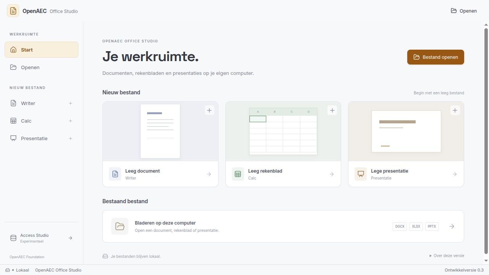
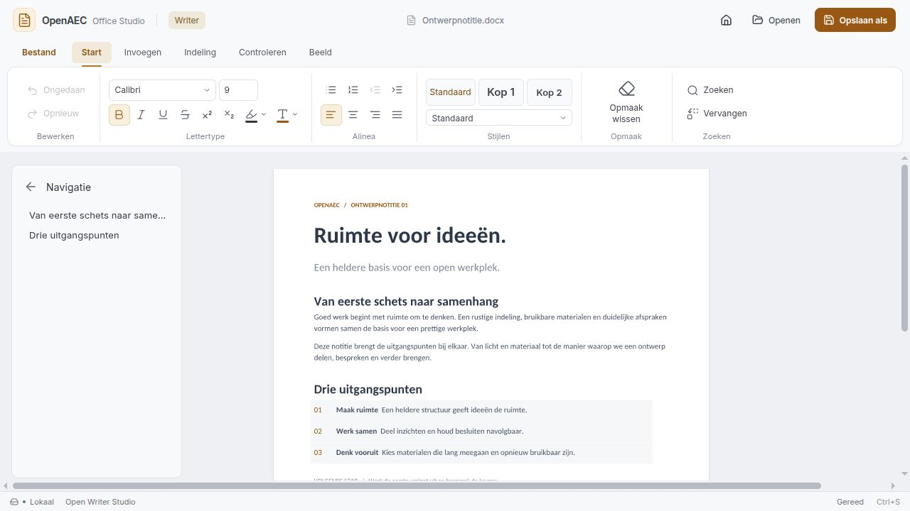
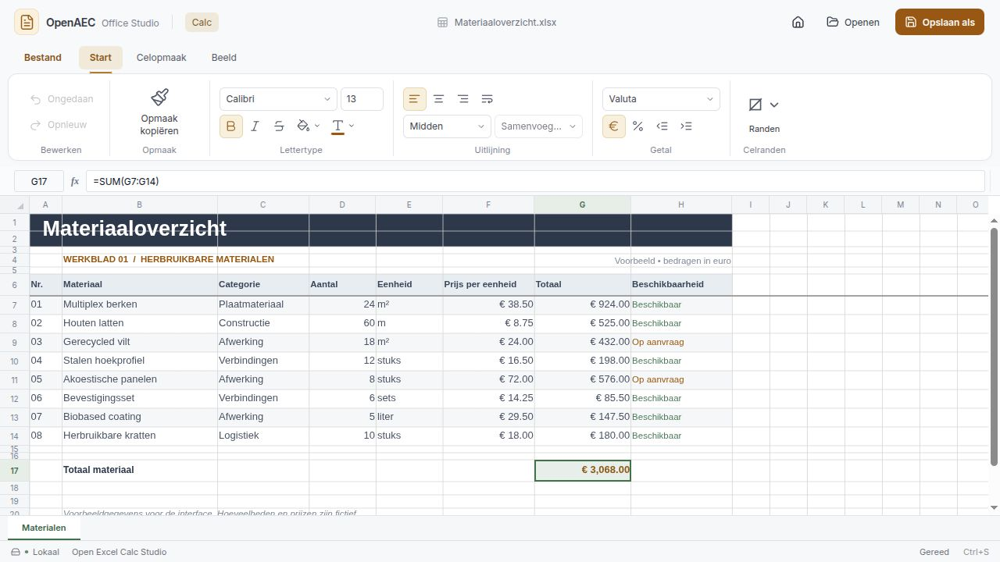
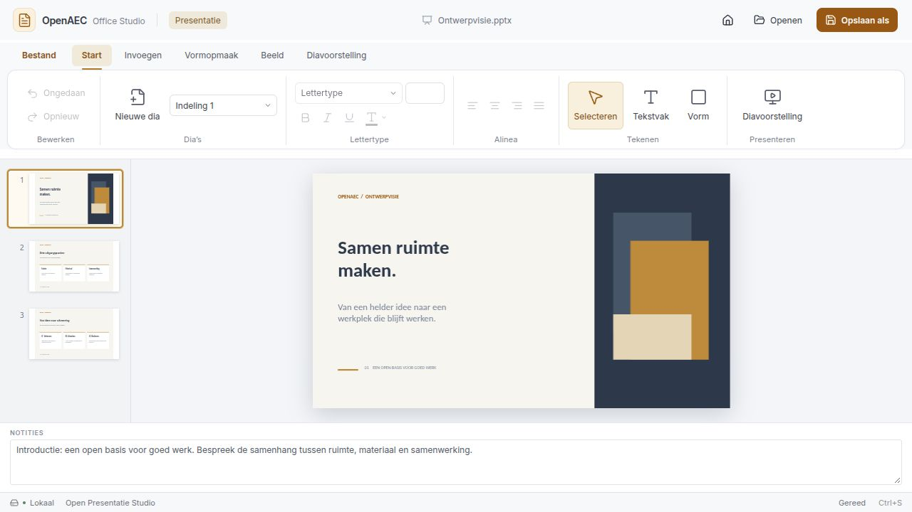

# Open Office Studio

Open-source kantoortoepassingen van het OpenAEC-ecosysteem voor tekstverwerking, rekenbladen en presentaties.



## In beeld

Werkelijke schermafbeeldingen van de lokale productiebuild, met de eigen [voorbeeldbestanden](docs/voorbeelden). De interface heeft een gedeelde ribbon, contextuele opdrachten en een lokaal bestandsmenu. Deze beelden tonen de ontwikkelversie; ze zijn geen verklaring van volledige formaatcompatibiliteit.

### Open Writer Studio

Paginaweergave met tekstopmaak, alineastijlen en documentnavigatie.



### Open Excel Calc Studio

Rekenblad met formulebalk, rij- en kolomkoppen, celopmaak en berekende materiaaltotalen.



### Open Presentatie Studio

Dia’s, vormen, tekst en sprekersnotities in één werkruimte.



## Modules

- **Open Writer Studio** — teksten schrijven, opmaken en opslaan.
- **Open Excel Calc Studio** — tabellen, formules en celopmaak bewerken.
- **Open Presentatie Studio** — dia’s maken, vormgeven en presenteren.

- **Open Access Studio** — experimentele voorbeeldopzet; database- en VBA-ondersteuning zijn nog niet geïmplementeerd. Deze module heeft de laagste prioriteit.

## Status

Een lokale React-werkruimte met drie aangesloten kantoorengines en een Tauri-desktopbasis is beschikbaar. Nieuw, openen en opslaan als zijn aangesloten; voor Access is er alleen een voorbeeldopzet. De suite is nog een ontwikkelprototype. Zie het [testverslag](docs/tests/2026-10-21.md) voor bewezen functionaliteit en ontbrekende releasecontroles.

De ontwikkeling met screenshots staat in [pull request #9](https://github.com/OpenAEC-Foundation/open-office-studio/pull/9). De [bouwcontroles](https://github.com/JanAdriaan891/open-office-studio/actions/workflows/desktop.yml) maken pakketten voor Windows x64, Linux x64 en macOS ARM64. Een geslaagde build vervangt geen installatie- en gebruikerstest.

## Opbouw

- `packages/documenten` — tekstverwerking.
- `packages/rekenbladen` — tabellen en formules.
- `packages/presentaties` — dia’s en presentatieweergave.

## Eerste ontwikkelstappen

1. Nederlandse editorbediening en de functionele acceptatieproeven afronden.
2. Native opslag, herstel en installers op alle doelplatformen testen.
3. Import en export van gangbare documentformaten uitwerken.

## Onderzoek

- [Uitgebreide inventarisatie](docs/onderzoek/landschap.md)
- [Routekeuze en licentieafweging](docs/onderzoek/README.md)
- [Versies en omvanggegevens](docs/onderzoek/metingen.md)
- [Bestaande Y-app-integratie](docs/onderzoek/integratie.md)

## Controles

Python 3.10 of nieuwer, zonder aanvullende pakketten:

```bash
python3 -m unittest discover -s tests -v
```

Zie de [testmatrix](docs/onderzoek/testmatrix.md) voor het vergelijken van DOCX-, XLSX- en PPTX-pakketten.

## Desktopontwikkeling

- [Functionele eisen en vergelijking met WordCraft en andere editors](docs/ontwerp/functionele-lat.md).
- `pnpm dev`: lokale kantooromgeving.
- `pnpm build`: TypeScript en productiebuild.
- `pnpm test`: adapter- en exportcontroles.

- `pnpm test:engines`: documenten wijzigen, opslaan en opnieuw openen met de echte engines.
- `pnpm desktop:dev`: Tauri-desktopomgeving.
- `pnpm desktop:build`: native pakket voor het huidige platform.
- [Testverslag en resterend werk](docs/tests/2026-10-21.md).
