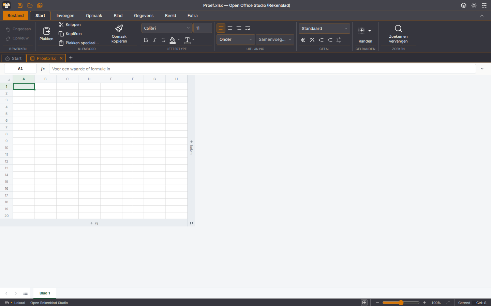
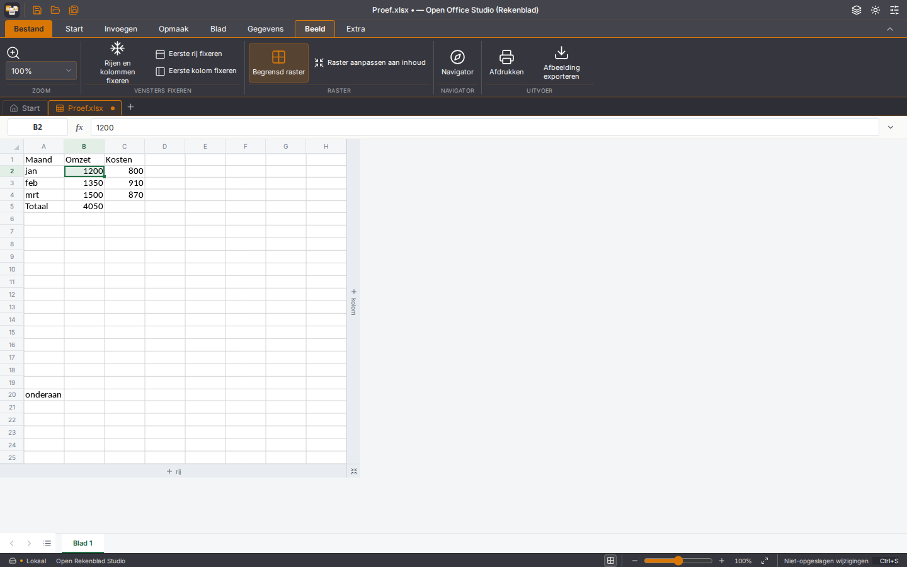
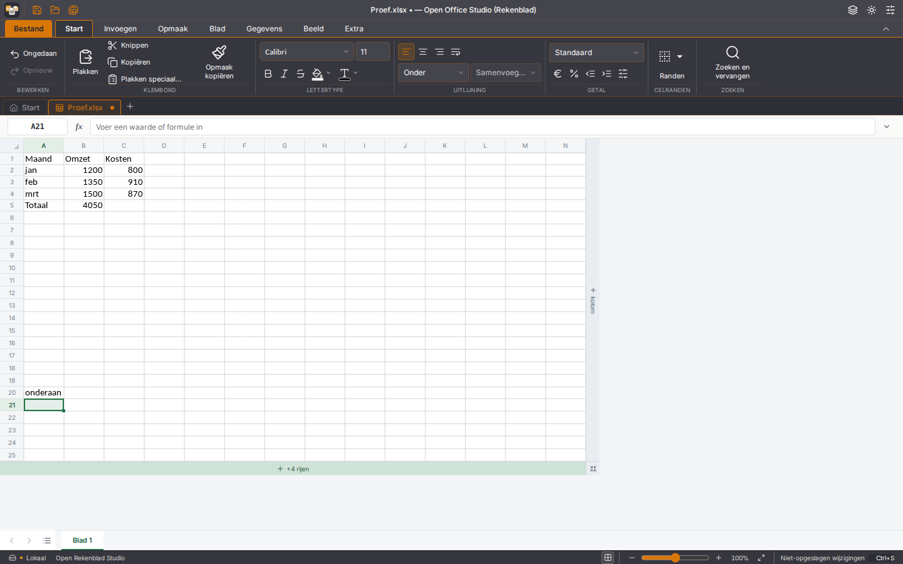
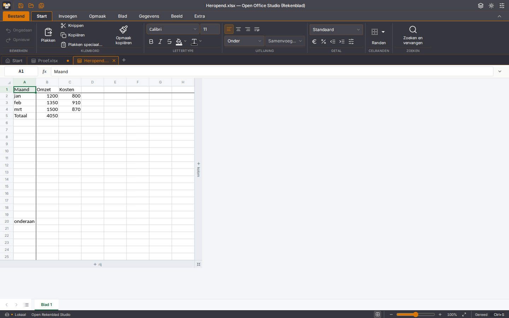

# Begrensd, meegroeiend raster in Rekenblad (#371)

Rekenblad kent twee weergaven van het raster, per blad te kiezen:

- **Onbeperkt raster** (standaard): het bekende raster dat in alle richtingen
  doorloopt.
- **Begrensd raster**: het blad toont het gebruikte gebied plus een marge.
  Daarbuiten staan geen cellen maar een rustig vlak, met langs de rechter- en
  onderrand een strook **+ kolom** en **+ rij**.

Het begrensde raster is een weergavelaag over het onbeperkte raster. Het
XLSX-model verandert niet: er worden geen rijen of kolommen verborgen, en
formules, verwijzingen, afdrukken, filters en grafieken werken op hetzelfde
blad als altijd.

| Leeg blad | Gevuld blad, groep Raster in Beeld |
| --- | --- |
|  |  |
| **Groeien door de strook + rij te slepen** | **Heropend uit XLSX** |
|  |  |

## Bediening

| Waar | Wat |
| --- | --- |
| Beeld › Raster › **Begrensd raster** | wisselt het actieve blad |
| Statusbalk, rasterknop | idem (aan/uit via *Statusbalk › weergaveknoppen*) |
| Instellingen › Bewerken › Rekenblad | standaardraster en marge (rijen, kolommen) |
| Strook **+ rij** / **+ kolom** | klik = 1 erbij, Shift+klik = 10 rijen of 5 kolommen, slepen = één per gesleept spoor |
| Beeld › **Raster aanpassen aan inhoud**, of het hoekje tussen de stroken | krimpt tot inhoud plus marge |

Er is geen sneltoets: de gangbare vrije combinaties zijn in Rekenblad al bezet.

## Omvang

- Omvang = gebruikt bereik + marge (standaard 5 rijen en 3 kolommen), met een
  beginraster van 20 rijen × 8 kolommen als ondergrens.
- Gebruikt bereik: cellen met gegevens, opmaak of een hyperlink (zoals de
  rekenkern die meldt), grafieken, afbeeldingen en vormen, tabellen, het
  autofilter en het afdrukbereik.
- Het raster **groeit vanzelf** zodra de inhoud de marge raakt: typen in de
  laatste rij of kolom, plakken, doorvoeren, invoegen.
- Het raster **krimpt nooit vanzelf**; dat gebeurt alleen met *Raster aanpassen
  aan inhoud*.
- **Ga naar, het naamvak en zoeken** naar een cel buiten het raster breiden het
  raster uit tot die cel (plus marge).
- **Toetsen en de muis** blijven binnen het raster: Ctrl+pijl en
  Shift+Ctrl+pijl stoppen op de rand, klikken in het lege vlak selecteert
  niets. Hele kolommen, hele rijen en *Alles selecteren* houden hun betekenis
  (het hele blad), zodat invoegen, verwijderen, breedte en hoogte gelijk blijven.
- De schuifbalken reiken tot de rand plus de groeistrook; past het raster in
  het venster, dan zijn er geen schuifbalken.

## Opslag van de keuze

De keuze reist op twee manieren mee, in deze volgorde van voorrang:

1. **In het bestand**, als aangepaste documenteigenschap
   `OpenOfficeStudio.BoundedGrid` in `docProps/custom.xml` (tekst, JSON):
   `{"v":1,"sheets":[{"name":"Blad 1","rows":25,"columns":11}],"unlimited":[]}`.
   Excel, LibreOffice en andere programma's tonen zo'n eigenschap hooguit onder
   *Eigenschappen › Aangepast* en bewaren haar; de inhoud van de werkmap
   verandert er niet door.
2. **Als app-voorkeur per bestandsnaam** (`openaec-rekenblad-raster` in de
   lokale opslag, de laatste 100 bestanden), voor bestanden die nog niet zijn
   opgeslagen of naar een formaat zonder eigenschappen gaan.
3. Anders geldt het **standaardraster** uit Instellingen.

De eigenschap wordt alleen geschreven als de gebruiker in deze werkmap zelf
een keuze maakte (of het bestand er al een had). Wie nooit wisselt, krijgt
dus geen extra onderdeel in zijn bestand. Bij opslaan veranderen uitsluitend
`docProps/custom.xml`, `[Content_Types].xml` en `_rels/.rels`.

Waarom geen `extLst` of verborgen rijen en kolommen:

- Verborgen rijen/kolommen veranderen het model (Excel toont ze als verborgen,
  filters en afdrukken reageren erop) en zijn dus geen zuivere weergavelaag.
- Een `extLst` in het werkblad vraagt een eigen naamruimte in elk blad en de
  rekenkern schrijft werkbladen zelf opnieuw; een documenteigenschap staat
  daar los van en raakt geen werkblad aan.

## Techniek

De rekenkern tekent altijd het onbeperkte raster op één canvas en kent geen
instelbare grens. De begrenzing zit daarom in onze eigen laag:

- `src/rekenblad/begrensdRaster.ts`: rekenregels en de documenteigenschap.
- `src/rekenblad/rasterWeergave.ts`: stand per werkmap en blad, gebruikt
  bereik, selectiebewaking, app-voorkeur.
- `src/rekenblad/BegrensdRasterLaag.tsx`: het vlak, de groeistroken en de
  melding voor schermlezers (`role="status"`).
- `src/RekenbladKoppen.tsx`: de koppen stoppen op de rand; de schuifruimte van
  de engine wordt met CSS-variabelen begrensd; muisklikken buiten het raster
  bereiken de engine niet.

## Grenzen

- Het canvas tekent de rasterlijnen onder het vlak nog steeds; het begrensde
  raster is dus niet sneller, maar ook niet trager. Het gebruikte bereik komt
  uit de inhoudsgrootte die de rekenkern al bijhoudt (geen extra doorloop van
  alle cellen per toetsaanslag); een onbeperkt blad doet geen extra werk.
- De verborgen toegankelijkheidsspiegel van de engine (`role="grid"`) bevat
  ook cellen buiten het raster die in het venster zouden vallen. De selectie
  kan daar niet komen en de rand wordt gemeld, maar een schermlezer in
  bladermodus kan die lege cellen tegenkomen.
- Opmaak van hele kolommen of rijen (zonder cellen) vergroot het raster niet.
- De app-voorkeur gaat op bestandsnaam, niet op het volledige pad.
